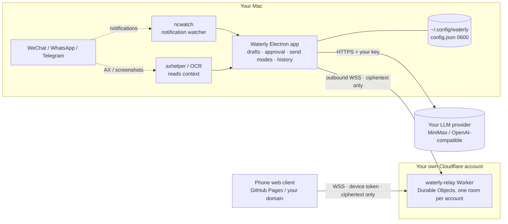

<p align="center">
  
</p>

<h1 align="center">Waterly</h1>

<p align="center"><b>An open-source, self-hosted AI reply assistant for WeChat, WhatsApp & Telegram — AI drafts, you decide.</b></p>

<p align="center"><a href="README.en.md">English</a> | <a href="README.md">简体中文</a></p>

<p align="center">
  <a href="LICENSE"></a>
  
  
  
</p>

> ⚠️ **Please read the [Disclaimer](DISCLAIMER.md) before use.** Automating WeChat can get your account banned. Out of the box, Waterly only drafts replies — it never sends on its own.

---

## Contents

- [Why Waterly](#why-waterly) · [Features](#features) · [Screenshots](#screenshots) · [Demo video](#demo-video) · [Architecture](#architecture)
- [Quick start](#quick-start) · [Bring your own API key](#bring-your-own-api-key) · [Self-hosting the relay and web client](#self-hosting-the-relay-and-web-client)
- [Disclaimer](#disclaimer) · [FAQ](#faq) · [License](#license)

## Why Waterly

- **Fully open source, no central server.** No accounts, no official backend. The app, the relay and the web client are all yours to deploy.
- **Bring your own key.** Use MiniMax or any OpenAI-compatible API (OpenAI, DeepSeek, Moonshot, local Ollama / vLLM…). Your key never leaves your Mac.
- **Human in the loop, always.** Auto-reply is off by default, the AI only writes drafts, and every message needs your approval before it goes out.
- **No cracking, no injection.** Waterly reads messages only through system notifications, macOS Accessibility (AX) and on-screen OCR. It never reads chat apps' local databases and never modifies any client.

## Features

| | Feature | Status |
|---|---|---|
| 📥 | Notification-banner watcher + AX / OCR to read chat context (WeChat, WhatsApp, Telegram) | ✅ |
| ✍️ | AI reply drafts with an adjustable **context length** (5–100 messages) and **reply persona** (in your own voice / customer support / assistant / custom) | ✅ |
| ✅ | Manual approval before sending; per-conversation allow/block rules | ✅ |
| 📋 | Send modes: **copy to clipboard** (default) or auto-type send (opt-in, requires acknowledging the ban risk; falls back to clipboard when the screen is locked) | ✅ |
| 🗂 | Local history that survives restarts, with configurable retention and one-click clear | ✅ |
| 📱 | Review and approve from your phone: self-hosted relay + **end-to-end encryption** + QR pairing + safety-number check + instant revocation | ✅ |
| 🔑 | First-run setup wizard: pick a provider, enter your own key | ✅ |
| 🧩 | QQ and WeCom adapters; auto-send for WhatsApp / Telegram | 🚧 |
| 🎙 | Optional extra `native/mac/grokcall`: a wake word starts a voice call with a desktop AI assistant (unrelated to the core app) | 🧪 |

## Screenshots

> All screenshots use **demo data** — no real conversations.

| Web client (desktop) | Phone: conversations | Phone: AI draft | Phone: pairing with a Mac |
|---|---|---|---|
|  |  |  |  |

## Demo video

<!-- TODO: Replace with demo video link -->
> 🎬 *Demo video coming soon.* `[[DEMO_VIDEO_PLACEHOLDER]]`

## Architecture



- The Mac app opens no inbound ports; it dials out to your relay. Traffic between phone and Mac is end-to-end encrypted, so the relay only ever sees ciphertext.
- Detailed design: [`docs/remote-relay-design.md`](docs/remote-relay-design.md) · Product overview (Chinese): [`docs/Waterly产品形态.md`](docs/Waterly产品形态.md)

## Quick start

Requirements: macOS 14+ (Apple Silicon), Node.js ≥ 22, Xcode Command Line Tools.

```bash
git clone https://github.com/<you>/waterly.git && cd waterly
npm install
npm run build && npm test     # OCR / e2e tests need a real Mac and the OCR sidecar; failures elsewhere are expected
npm run native                # build the Swift helpers ncwatch / axhelper
npm start                     # run in development mode
npm run dist:mac              # package release/mac-arm64/Waterly.app (ad-hoc signed)
```

On first launch a setup wizard asks for your own API key (see below). Then grant permissions in System Settings:

- **Accessibility** — to read notification banners and windows, and to simulate paste + Return in auto-type send mode
- **Screen Recording** — for OCR (optional)

Optional OCR sidecar: `python3 -m venv .venv && .venv/bin/pip install -r sidecar/requirements.txt`.

## Bring your own API key

Waterly ships with **no built-in key**. Configure one in the first-run wizard or under Model Settings:

| Provider | Example base URL | Example model |
|---|---|---|
| MiniMax | `https://api.minimaxi.com/v1` | `MiniMax-M2` |
| OpenAI-compatible | `https://api.openai.com/v1` · `https://api.deepseek.com/v1` · `http://localhost:11434/v1` (Ollama) | `gpt-4o-mini` · `deepseek-chat` · `qwen2.5` |

- The key is stored locally in `~/.config/waterly/config.json` (mode 0600) and used only by the main process — never sent to the UI, the relay or your phone.
- For development you can also set the `WATERLY_API_KEY` (or `MINIMAX_API_KEY`) environment variable.

## Self-hosting the relay and web client

You only need these if you want **remote access from your phone**.

### 1. Relay (Cloudflare Workers — the free plan is enough)

```bash
cd relay
./scripts/deploy.sh --origin https://<your-web-client-host> [--domain relay.example.com] [--registration-key]
```

Full instructions: [`relay/README.md`](relay/README.md). `REGISTRATION_KEY` is optional; when set, only Macs that know it can register on your relay.

### 2. Web client (a single HTML file)

The web client is just [`docs/waterly-aggregate-chat.html`](docs/waterly-aggregate-chat.html) — fully static, no build step.

- **GitHub Pages:** fork the repo, then under Settings → Pages choose the `main` branch and the `/docs` folder. Open `https://<you>.github.io/waterly/` (`docs/index.html` redirects to the web client).
- **Your own domain:** drop the HTML file on any static host (Cloudflare Pages, Nginx, Vercel…).
- **Default relay:** edit `<meta name="waterly-relay" content="https://relay.example.com">` in the HTML head, enter it in the page under Connect Mac → Relay server, or pass `?relay=` in the URL.
- Remember to add your web client's origin to the relay's `ALLOWED_ORIGINS`.

### 3. Connect

On the Mac, open Waterly → Remote Access: enter the relay URL, the web client URL (and the optional registration key) → turn the switch on → Add Device. On your phone, open the web client → Connect Mac → scan the QR code or type the pairing code → check that the 6-digit safety numbers match on both sides.

## Disclaimer

**Waterly is not affiliated with Tencent, Meta, Telegram or any other platform.** Automating chat clients may violate their terms of service, and enabling auto-type send for WeChat **can get your account restricted or permanently banned**. By default Waterly only drafts replies and copies them to the clipboard, auto-reply is off, and every send needs your confirmation. Use it only on your own accounts, at your own risk. See [DISCLAIMER.md](DISCLAIMER.md) for the full text.

## FAQ

**Can my account get banned?**
Yes, there is a risk. The default mode — reading notifications and windows, copying replies to the clipboard — carries the lowest risk. Auto-type send simulates keyboard input and is noticeably riskier. Test with WeChat's File Transfer chat or a secondary account first.

**Where does my chat content go?**
Only to the LLM provider you configure, to generate drafts. With remote access, everything passing through your own relay is end-to-end encrypted. The project itself runs no servers at all.

**Do I have to deploy the relay?**
No. If you only use Waterly on your Mac, you need neither the relay nor the web client.

**Does it support Windows or Linux?**
Not yet — macOS only for now. The screen-reading layer (`src/platform`) is abstracted, and contributions for other platforms are welcome.

**Why not just read the WeChat database?**
That would mean decrypting or reading app data without authorization — effectively cracking — with far greater risk and compliance problems. Waterly deliberately does not do it.

**Can I use a local model?**
Yes. Choose "OpenAI-compatible" and set the base URL to `http://localhost:11434/v1` (Ollama) or your vLLM endpoint.

**I lost my relay registration key. What now?**
Run `wrangler secret put REGISTRATION_KEY` again and enter the new value on the Mac. Phones that are already paired are unaffected.

## License

[MIT](LICENSE) © 2026 Waterly contributors
