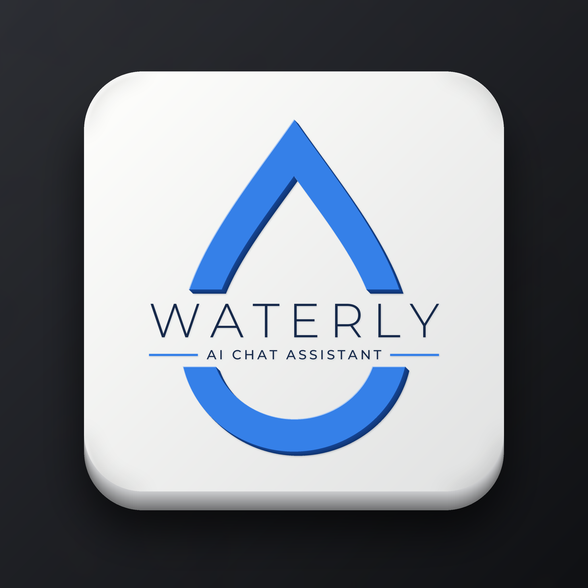
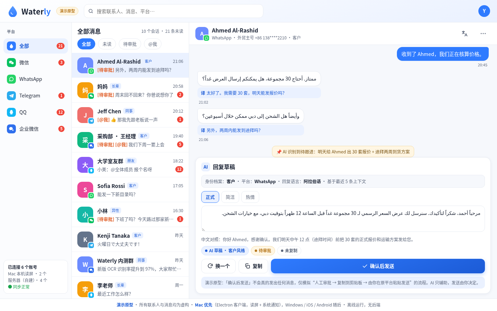
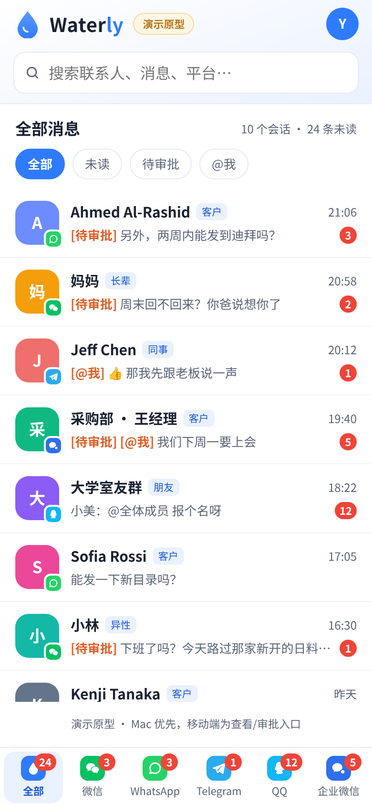
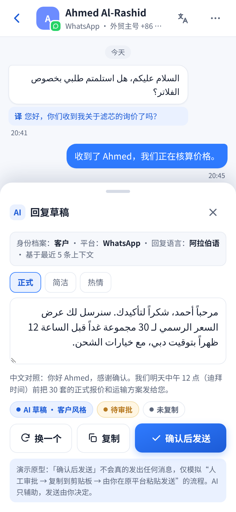
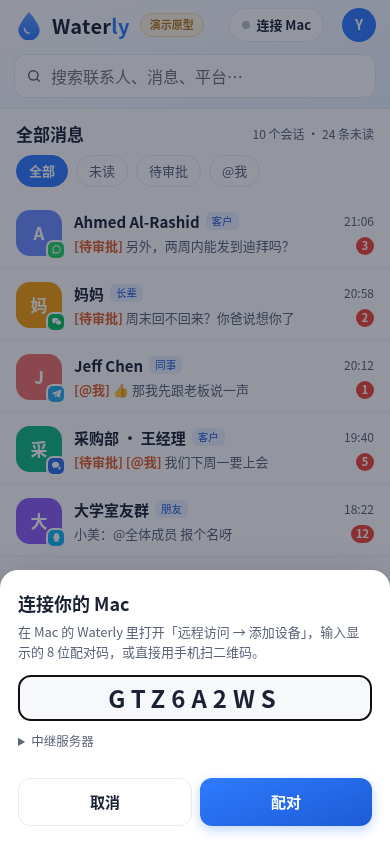
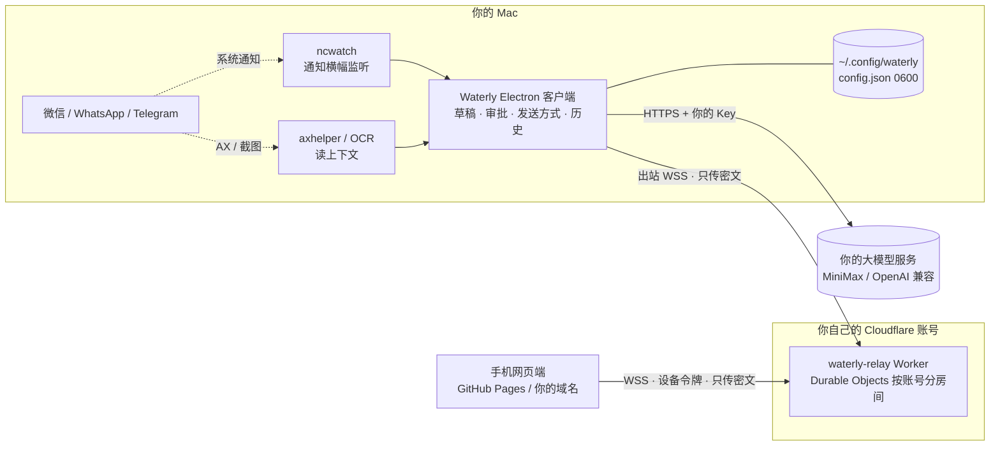

<p align="center">
  
</p>

<h1 align="center">Waterly</h1>

<p align="center"><b>开源、自部署的多平台聊天 AI 回复助手：AI 起草，你来拍板。</b></p>
<p align="center"><a href="README.en.md">English</a> | <a href="README.md">简体中文</a></p>

<p align="center">
  <a href="LICENSE"></a>
  
  
  
</p>

> ⚠️ **使用前请先读 [风险声明](DISCLAIMER.md)。** 自动化操作微信可能导致封号。Waterly 默认只起草、不自动发送。

---

## 目录

- [为什么是 Waterly](#为什么是-waterly) · [功能](#功能) · [截图](#截图) · [演示视频](#演示视频) · [架构](#架构)
- [快速开始](#快速开始) · [自带 API Key](#自带-api-keybyo-key) · [自部署中继与网页端](#自部署中继与网页端)
- [风险声明](#风险声明) · [FAQ](#faq) · [English](README.en.md) · [License](#license)

## 为什么是 Waterly

- **全开源、无中心服务器**：没有账号、没有官方后台。代码、中继、网页端都可以你自己部署。
- **自带 Key**：MiniMax 或任何 OpenAI 兼容接口（OpenAI、DeepSeek、Moonshot、本地 Ollama / vLLM……），Key 只存在你的 Mac 上。
- **人始终在环**：自动回复默认关闭；AI 只生成草稿；每一条发送都要你确认。
- **不破解、不注入**：只用系统通知、辅助功能（AX）和截图识别读消息，不读聊天应用的本地数据库，不修改任何客户端。

## 功能

| | 功能 | 状态 |
|---|---|---|
| 📥 | 通知横幅监听 + AX / OCR 读取聊天上下文（微信、WhatsApp、Telegram） | ✅ |
| ✍️ | AI 回复草稿：可调 **上下文条数**（5–100）和 **回复身份**（本人口吻 / 客服 / 助理 / 自定义） | ✅ |
| ✅ | 发送前人工审批；会话黑白名单规则 | ✅ |
| 📋 | 发送方式：**复制到剪贴板**（默认）/ 自动输入发送（可选，需确认封号风险，锁屏时自动降级为复制） | ✅ |
| 🗂 | 本地历史记录（重启不丢，可设保留天数、一键清空） | ✅ |
| 📱 | 手机远程查看与审批：自部署中继 + **端到端加密** + 扫码配对 + 安全码校验 + 随时吊销 | ✅ |
| 🔑 | 首次启动设置向导：选服务商、填自己的 Key | ✅ |
| 🧩 | QQ、企业微信适配器；WhatsApp / Telegram 自动发送 | 🚧 |
| 🎙 | 可选小工具 `native/mac/grokcall`：唤醒词触发桌面 AI 助手语音通话（与核心无关） | 🧪 |

## 截图

> 截图均为**演示数据**，不含真实聊天。

| 网页端（桌面） | 手机：会话列表 | 手机：AI 草稿 | 手机：配对 Mac |
|---|---|---|---|
|  |  |  |  |

## 演示视频

<!-- TODO: 替换为演示视频链接 / Replace with demo video link -->
> 🎬 演示视频即将上线 · *Demo video coming soon.* `[[DEMO_VIDEO_PLACEHOLDER]]`

## 架构



- 客户端不开放任何端口，主动连出到你的中继；手机和 Mac 之间端到端加密，中继只能看到密文。
- 详细设计：[`docs/remote-relay-design.md`](docs/remote-relay-design.md) · 产品形态：[`docs/Waterly产品形态.md`](docs/Waterly产品形态.md)

## 快速开始

需要：macOS 14+（Apple Silicon）、Node.js ≥ 22、Xcode Command Line Tools。

```bash
git clone https://github.com/<you>/waterly.git && cd waterly
npm install
npm run build && npm test     # OCR / e2e 测试需要真机与 OCR 侧车，其他环境失败属正常
npm run native                # 编译 ncwatch / axhelper（Swift）
npm start                     # 开发模式运行
npm run dist:mac              # 打包 release/mac-arm64/Waterly.app（ad-hoc 签名）
```

首次打开会弹出设置向导，填你自己的 API Key（见下节）。然后在系统设置里授予权限：

- **辅助功能**：读通知横幅和窗口；「自动输入发送」时模拟粘贴回车
- **屏幕录制**：截图识别（可选）

可选 OCR 侧车：`python3 -m venv .venv && .venv/bin/pip install -r sidecar/requirements.txt`。

## 自带 API Key（BYO key）

Waterly **不内置任何 Key**。首次启动或在「模型设置」里：

| 服务商 | Base URL 示例 | 模型示例 |
|---|---|---|
| MiniMax | `https://api.minimaxi.com/v1` | `MiniMax-M2` |
| OpenAI 兼容 | `https://api.openai.com/v1` · `https://api.deepseek.com/v1` · `http://localhost:11434/v1`（Ollama） | `gpt-4o-mini` · `deepseek-chat` · `qwen2.5` |

- Key 保存在本机 `~/.config/waterly/config.json`（权限 0600），只在主进程使用，不会发给界面、中继或手机。
- 开发时也可用环境变量 `WATERLY_API_KEY`（或 `MINIMAX_API_KEY`）。

## 自部署中继与网页端

只在需要**手机远程查看**时才需要。

### 1. 中继（Cloudflare Workers，免费套餐即可）

```bash
cd relay
./scripts/deploy.sh --origin https://<你的网页端域名> [--domain relay.example.com] [--registration-key]
```

完整说明见 [`relay/README.md`](relay/README.md)。`REGISTRATION_KEY` 可选：设置后只有知道它的 Mac 能在你的中继上注册。

### 2. 网页端（单个 HTML 文件）

网页端就是 [`docs/waterly-aggregate-chat.html`](docs/waterly-aggregate-chat.html)，纯静态，没有构建步骤。

- **GitHub Pages**：Fork 后在仓库 Settings → Pages 选 `main` 分支、`/docs` 目录，访问 `https://<you>.github.io/waterly/`（`docs/index.html` 会跳转到网页端）。
- **自己的域名**：把这个 HTML 放到任意静态托管（Cloudflare Pages、Nginx、Vercel……）。
- **默认中继**：编辑 HTML 头部的 `<meta name="waterly-relay" content="https://relay.example.com">`；也可以在页面「连接 Mac → 中继服务器」里填，或用 `?relay=` 参数。
- 记得把网页端域名写进中继的 `ALLOWED_ORIGINS`。

### 3. 连接

Mac 上 Waterly →「远程访问」：填中继地址、网页端地址（和可选的注册密钥）→ 打开开关 →「添加设备」。手机打开网页端 →「连接 Mac」→ 扫码或输入配对码 → 核对两边的 6 位安全码。

## 风险声明

**Waterly 与腾讯、Meta、Telegram 等平台无关。** 自动化操作聊天客户端可能违反平台条款；为微信开启「自动输入发送」**可能导致账号被限制或永久封禁**。Waterly 默认只起草、复制到剪贴板，自动回复默认关闭，每条发送都需要你确认。请只用于自己的账号，风险自负。完整内容见 [DISCLAIMER.md](DISCLAIMER.md)。

## FAQ

**会不会被封号？**
有风险。只读通知和窗口、复制到剪贴板的默认模式风险最低；「自动输入发送」会模拟键盘操作，风险明显更高。建议先用文件传输助手或小号测试。

**我的聊天内容会上传到哪里？**
只会发给你自己配置的大模型服务（用于生成草稿）。远程访问时，经过你自己中继的内容是端到端加密的密文。项目本身没有任何服务器。

**必须部署中继吗？**
不用。只在 Mac 上用的话，不需要中继和网页端。

**支持 Windows / Linux 吗？**
暂不支持，目前只做 macOS。读屏层（`src/platform`）是抽象的，欢迎贡献其他平台实现。

**为什么不直接读微信数据库？**
那需要解密或越权读取应用数据，属于破解行为，风险和合规问题都更大。Waterly 明确不做。

**能用本地模型吗？**
可以。选「OpenAI 兼容接口」，Base URL 填 `http://localhost:11434/v1`（Ollama）或你的 vLLM 地址。

**中继的注册密钥丢了怎么办？**
重新 `wrangler secret put REGISTRATION_KEY`，再在 Mac 端填新值即可；已配对的手机不受影响。

## English

The full English documentation is in **[README.en.md](README.en.md)**.

## License

[MIT](LICENSE) © 2026 Waterly contributors
