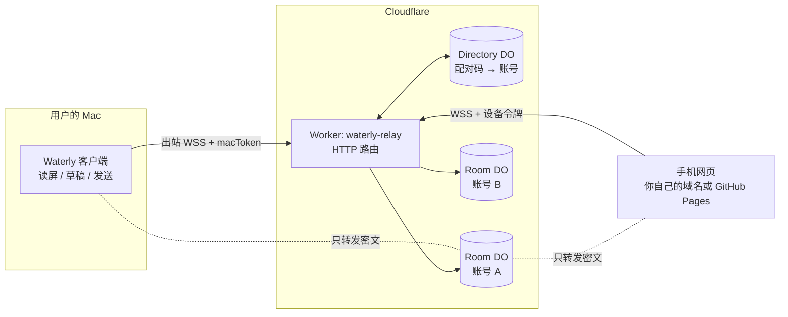
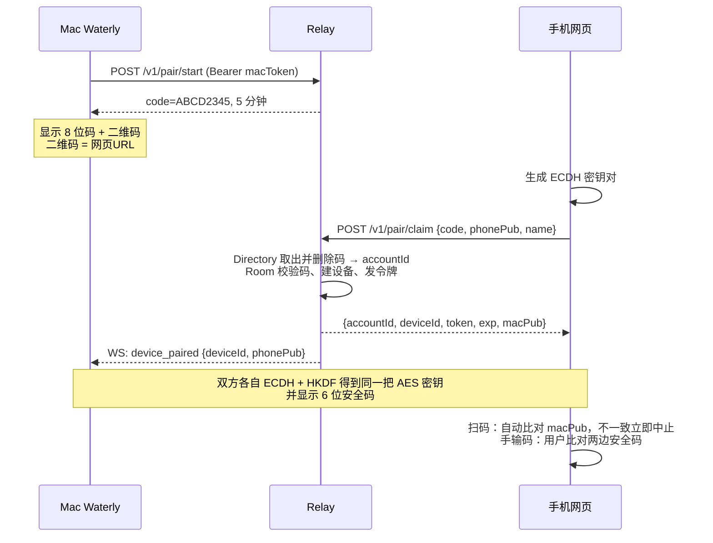
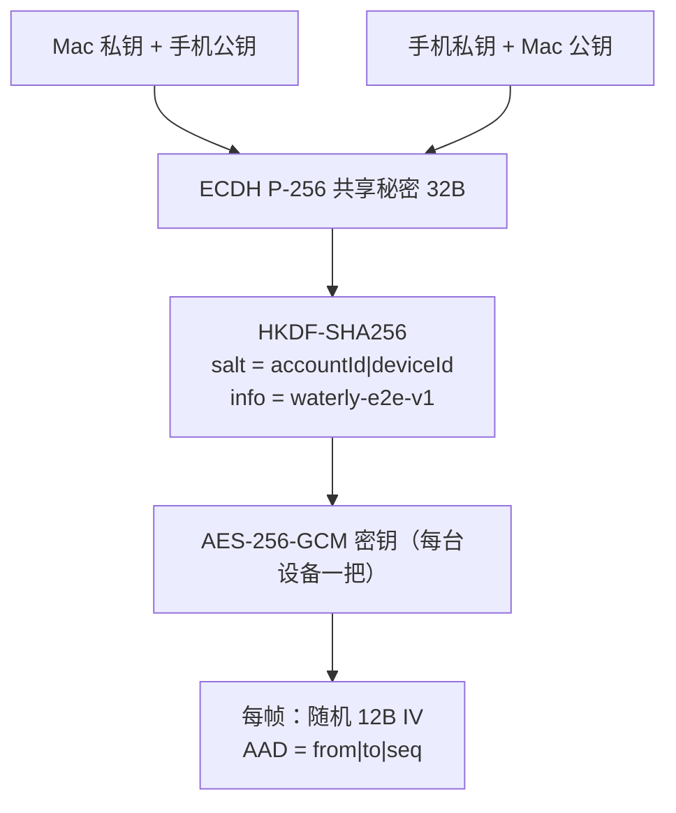
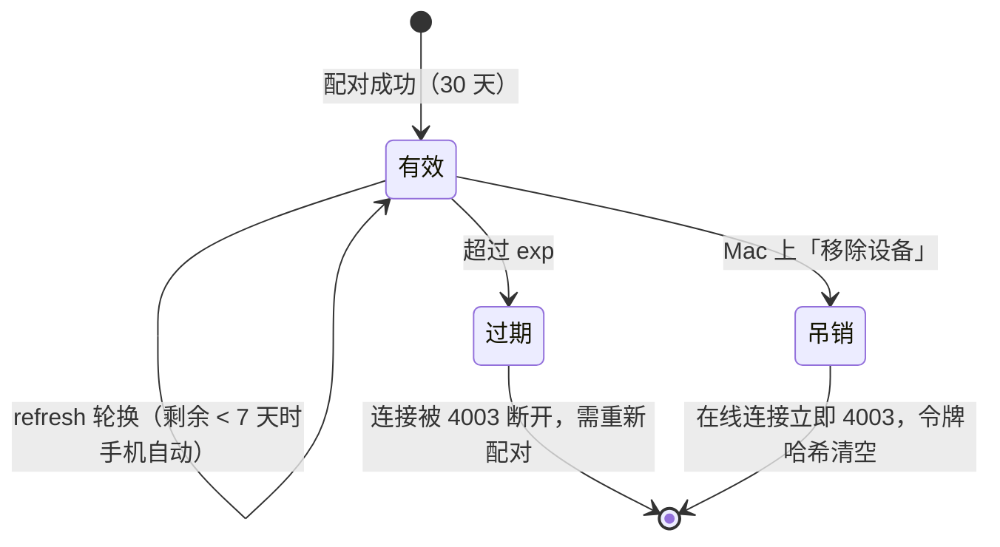

# Waterly 远程访问设计（中继 + 配对 + 端到端加密）

> 状态：已确认方案，原型已实现（`relay/`、`relay/mac-agent/`、`docs/waterly-aggregate-chat.html`）。
> 一句话：**Mac 和手机都主动连到同一台中继服务器，服务器按账号把它们放进同一个“房间”转发，内容端到端加密，服务器看不到聊天。**

## 1. 目标与原则

| 目标 | 做法 |
|---|---|
| 任何网络下手机都能看 Mac 上的聊天 | Mac 主动向中继建立 WebSocket 长连接，不开任何入站端口，不需要公网 IP / 内网穿透 |
| 一个用户一个连接，别人登不进来 | 一个账号 = 一个 Durable Object 房间；每台设备必须配对，拿到自己的令牌 |
| 服务器被攻破也不泄露聊天 | Mac ⇄ 手机端到端加密，中继只看到密文 |
| 真正执行操作的永远是 Mac | 手机只发“指令”，Mac 本地执行；发送需要手机二次确认，Mac 端仍走原有审批/发送方式 |

## 2. 架构



- **Worker**：无状态入口，做参数校验、CORS、把请求路由到对应账号的 Room。
- **Room DO（每个账号一个，`idFromName(accountId)`）**：存 Mac 公钥、macToken 哈希、设备表；持有该账号所有 WebSocket（使用 Hibernation API，空闲不计费）；负责认证与转发。
- **Directory DO（全局一个）**：只存 `sha256(配对码) → accountId`，一次性、限时；按 IP 计数防爆破。

## 3. 身份与凭证

| 凭证 | 谁持有 | 服务端存什么 | 寿命 |
|---|---|---|---|
| `accountId` | Mac、已配对手机 | 明文（作为房间名） | 永久 |
| `macToken`（32 字节随机） | 仅 Mac（本地 0600 文件 / 钥匙串） | SHA-256 哈希 | 永久，可重置 |
| Mac 身份密钥对（ECDH P-256） | 私钥仅在 Mac | 公钥 `macPub` | 永久 |
| 配对码（8 位，去易混字符，约 40 bit） | Mac 屏幕 → 用户 | SHA-256 哈希 | 5 分钟、一次性 |
| 设备令牌（32 字节随机） | 单台手机 | SHA-256 哈希 + 过期时间 + 吊销标记 | 30 天，可轮换、可吊销 |
| 手机密钥对（ECDH P-256） | 私钥仅在该手机 | 公钥 `phonePub` | 随设备 |

> 原型里“账号”由 Mac 首次启动时注册生成（`POST /v1/accounts`；部署者可选设置 `REGISTRATION_KEY`，只允许持有该值的 Mac 注册）。开源自部署模式下没有中心账号体系，每个人用自己的中继。

## 4. 配对流程



要点：
- 码只存哈希、一次性、5 分钟过期；同一 IP 10 分钟内失败 10 次即 429。
- 扫码时二维码里带着 Mac 公钥，手机自动校验，**中继无法偷换公钥**；手输码时靠 6 位安全码人工比对（与 Signal 的安全码同理）。

## 5. 连接与协议

WebSocket：`wss://relay.example.com/v1/ws?account=<accountId>`。令牌**不放 URL**（避免进日志），连上后 5 秒内必须发首帧认证，否则 4001 断开。

### 5.1 明文控制帧（relay 可见，只含元数据）

| 方向 | 帧 | 说明 |
|---|---|---|
| 客户端→relay | `{t:"auth", role:"mac", token}` / `{t:"auth", role:"phone", deviceId, token}` | 首帧认证 |
| relay→客户端 | `{t:"ready", role, macOnline}` | 认证成功 |
| relay→双方 | `{t:"presence", deviceId, online}` | Mac/手机上下线 |
| relay→Mac | `{t:"device_paired", deviceId, name, phonePub, exp}` | 新设备 |
| Mac→relay | `{t:"list_devices"}` → `{t:"devices", list}` | 设备列表（重连后恢复各设备密钥） |
| Mac→relay | `{t:"revoke", deviceId}` → `{t:"revoked"}` | 吊销，在线连接以 4003 踢下线 |
| 手机→relay | `{t:"refresh"}` → `{t:"token", token, exp}` | 令牌轮换，旧令牌立即失效 |
| 双向 | `{t:"ping"}` / `{t:"pong"}` | 保活 |

关闭码：4001 未认证/令牌无效，4002 被新的 Mac 连接替换，4003 已吊销/过期，1009 帧过大（>256KB）。

### 5.2 加密信封（relay 只转发）

```json
{"t":"e2e","from":"mac|<deviceId>","to":"mac|<deviceId>","seq":1739..., "iv":"<b64url>","ct":"<b64url>"}
```
`from` 由 relay 按连接身份填写，客户端无法伪造。手机发出的信封只投递给本账号的 Mac；Mac 发出的只投递给 `to` 指定的本账号设备。

### 5.3 加密层内的业务消息

| 方向 | 消息 | 说明 |
|---|---|---|
| 手机→Mac | `{type:"hello"}` | 请求全量快照 |
| Mac→手机 | `{type:"snapshot", convs:[...]}` | 会话列表 + 最近消息 + 草稿 |
| Mac→手机 | `{type:"message", convId, msg, draft?}` | 新消息 / 已发送回显 / 新草稿 |
| 手机→Mac | `{type:"send", id, convId, text, confirmed:true}` | 发送（或采纳草稿后发送） |
| Mac→手机 | `{type:"ack", id, ok, error?}` | 执行结果，`confirm_required` / `bad_command` |

Mac 收到 `send` 后仍按客户端里的「发送方式」执行（默认复制到剪贴板；自动输入需用户已开启并接受封号风险），不会因为远程指令绕过本地设置。

### 5.4 重连

Mac 与手机都按 0.5s → 1s → 2s → 5s → 10s 退避重连，成功后清零；收到 4001/4003 不重连（手机清除本地配对、提示重新配对）。Mac 重连后发 `list_devices` 恢复各设备通道；手机收到 Mac 上线的 `presence` 后自动发 `hello` 拉快照。

## 6. 端到端加密



- 曲线选择：方案里提到 X25519；原型用 **ECDH P-256**，因为 WebCrypto 的 X25519 在部分 iOS/安卓浏览器仍不可用。接口已封装在 `relay/shared/e2e.js`，支持面齐了可以直接换成 X25519，协议不变。
- **防重放 / 防篡改**：AAD 绑定发送方、接收方和序号；接收方要求 `seq` 严格递增，重放或换收件人都会解密失败。
- 每台设备独立密钥：吊销一台手机不影响其它设备。
- 安全码：`SHA-256("waterly-sas|macPub|phonePub")` 取 6 位十进制。
- 后续增强（未在原型中）：会话级临时密钥做前向保密（每次连接再做一次临时 ECDH）；手机私钥改为 IndexedDB 中的不可导出 CryptoKey（原型存在 localStorage）。

## 7. 令牌生命周期与吊销



- 服务端只存令牌哈希；比对用常量时间比较。
- Room 的 alarm 定期检查在线手机，过期即断开。
- Mac 上的「远程访问」页列出所有设备（名称、在线状态、到期时间），一键吊销。
- 丢手机：在 Mac 上吊销即可；即便攻击者拿到旧的密文记录，没有手机私钥也解不开。
- macToken 泄露：在 Mac 上“重置账号密钥”→ 重新注册，所有设备需重新配对（正式版由登录体系处理）。

## 8. 威胁模型

| 威胁 | 影响 | 缓解 |
|---|---|---|
| 别人连进我的房间 | 看到/操控我的聊天 | 房间按 accountId 隔离；必须有本账号的有效设备令牌；accountId 本身不是凭证 |
| 猜配对码 | 偷配对 | 8 位 32 字符集（≈1.1×10¹²）、5 分钟、一次性、按 IP 限流 10 次/10 分钟；Mac 上会显示新设备通知与安全码 |
| 中继被攻破 / 运营方偷看 | 读聊天 | E2E 加密，中继只有密文和元数据（谁在线、消息大小与时间） |
| 中继偷换公钥做中间人 | 读聊天 | 扫码自动校验 macPub；手输码比对安全码 |
| 重放“发送”指令 | 重复发消息 | AAD 含 seq，接收方要求单调递增；指令带 id |
| 手机被偷 / 网页 XSS | 远程发消息 | 发送需二次确认（原型 `confirm`，正式版 Face ID / PIN）；Mac 端吊销；Mac 仍按本地发送方式执行；页面不加载第三方脚本，建议加 CSP |
| 令牌泄露（日志、URL） | 冒充设备 | 令牌不进 URL，首帧认证；只存哈希；30 天过期 + 轮换 |
| DoS / 大帧 | 资源耗尽 | 帧 ≤256KB；5 秒认证超时；可加 Cloudflare Rate Limiting 规则 |
| 微信封号风险 | 账号被封 | 远程只是把“发送”交给 Mac 的既有流程；默认复制到剪贴板，不新增自动操作 |

**不防的**：Mac 本身被入侵（攻击者等同于你本人）；用户手输码时不比对安全码且中继恰好是恶意的。

## 9. 部署（自部署，详见 `relay/README.md`）

- Worker：`waterly-relay`（`relay/wrangler.toml`），入口 `src/index.js`
- Durable Objects：`ROOMS` → `Room`，`DIRECTORY` → `Directory`，迁移 `v1`（`new_sqlite_classes`）
- 路由：你自己的自定义域，例如 `relay.example.com`（或直接用 `*.workers.dev`）
- 变量：`ALLOWED_ORIGINS = "https://<你的网页端域名>"`（生产不要用 `*`），`DEVICE_TOKEN_TTL_DAYS = "30"`，`PAIR_CODE_TTL_SEC = "300"`
- Secret：可选 `REGISTRATION_KEY`（`wrangler secret put REGISTRATION_KEY`），在 Mac 端「远程访问 → 注册密钥」里填同一个值
- 网页：`docs/waterly-aggregate-chat.html` 部署到你自己的域名或 GitHub Pages；没有内置默认中继，用页面里的「中继服务器」、`?relay=` 或 `<meta name="waterly-relay">` 指定

## 10. 本地运行与测试

```bash
cd relay && npm install          # 需要 Node ≥ 22（wrangler 4）
npm test                         # 自动起 wrangler dev，跑配对/E2E/发送确认/轮换/吊销/隔离/限流/重连
npx wrangler dev --port 8787     # 本地中继
node mac-agent/agent.js --relay http://127.0.0.1:8787 --pair --demo   # 模拟 Mac，打印配对码
# 打开 docs/waterly-aggregate-chat.html?relay=http://127.0.0.1:8787 → 右上角「连接 Mac」→ 输入配对码
```

## 11. 接入真实客户端的下一步

1. Electron 主进程加 `RelayClient`（复用 `shared/e2e.js` 与 mac-agent 逻辑），macToken/私钥存钥匙串（`safeStorage`）。
2. 设置里加「远程访问」：开关（默认关）、添加设备（码 + 二维码）、设备列表与吊销。
3. 把读屏得到的会话/消息/草稿映射成 `snapshot` / `message`；`send` 指令进入现有审批与发送方式流程。
4. 账号与 Waterly 登录体系打通；手机端二次确认换成 WebAuthn（Face ID / 指纹）。
